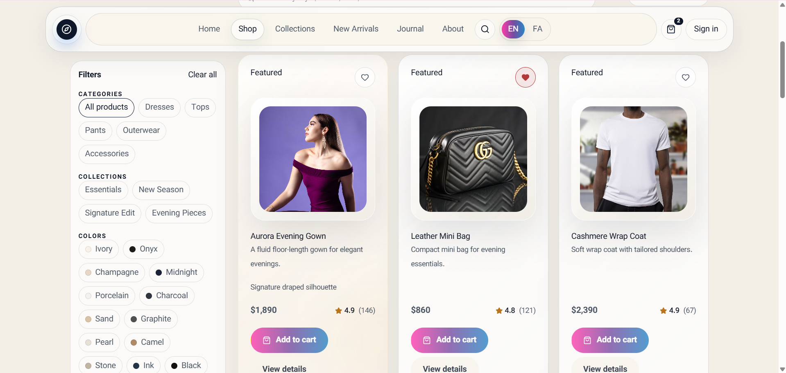
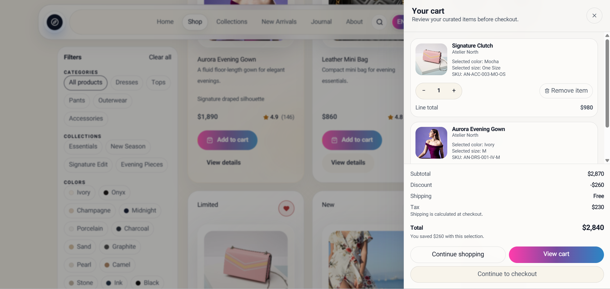
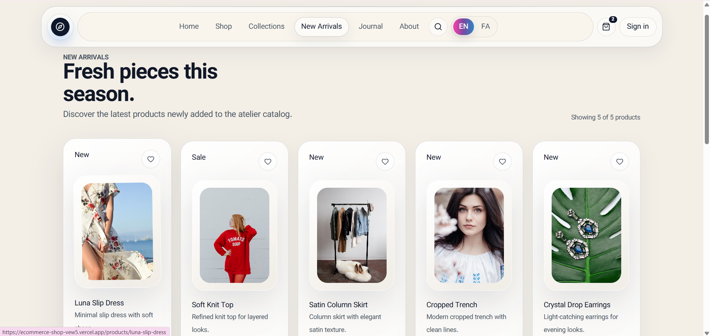
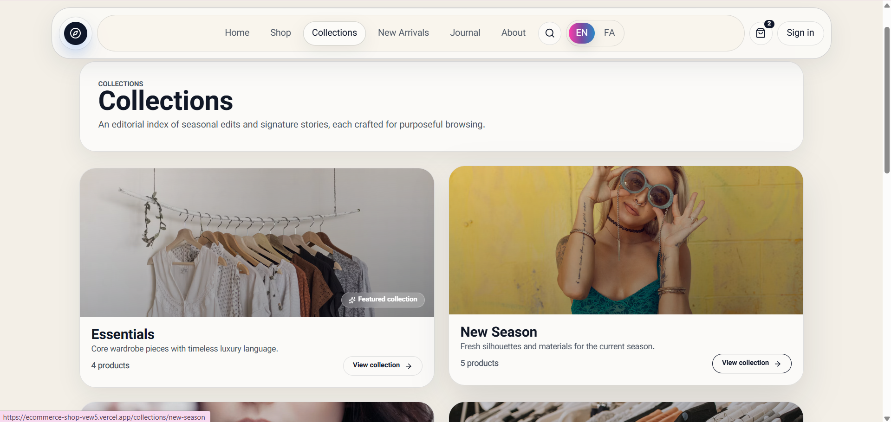
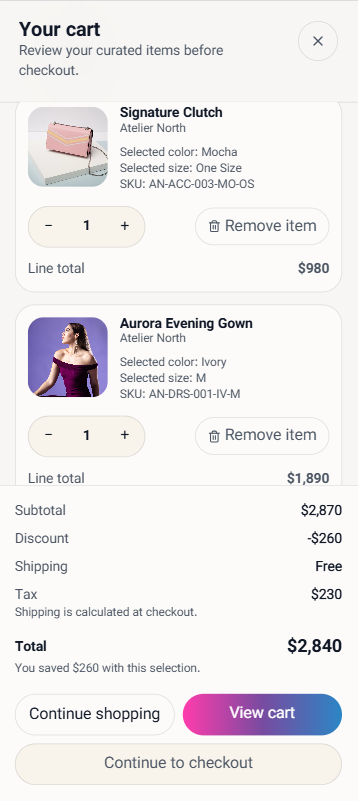
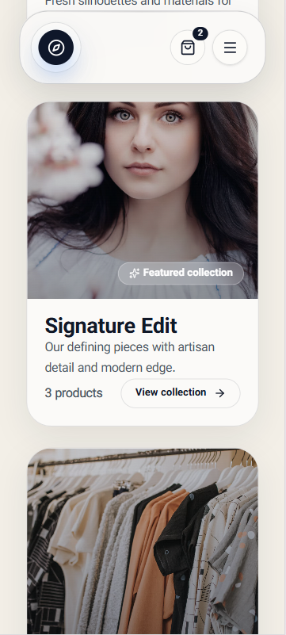
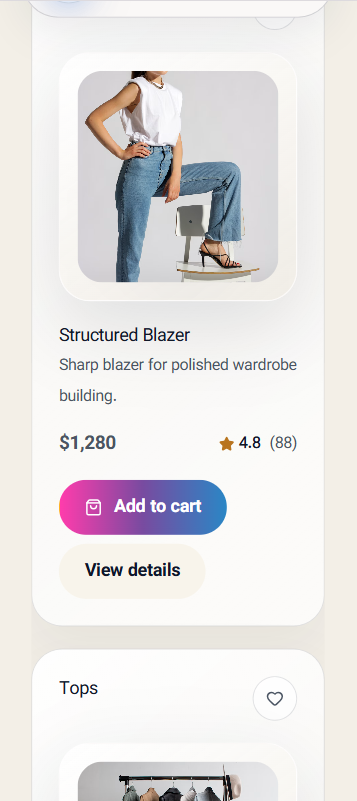

# Ecommerce Shop

### A responsive fashion & accessories storefront built with React and TypeScript

A portfolio e-commerce application focused on **maintainable front-end architecture**, **predictable state management**, and **modern shopping interfaces**. It brings together React UI development, client-side state, asynchronous data handling, typed forms, and a testable development setup.

[**Live Demo ↗**](https://ecommerce-shop-vew5.vercel.app/home) · [**Source Code ↗**](https://github.com/Matin-Pezham/Ecommerce-shop) · [**Developer on GitHub ↗**](https://github.com/Matin-Pezham) · [**Dexoura ↗**](https://dexoura.com)

> **Project type:** Personal portfolio / demonstration project. The storefront is **not** presented as a live commercial store, a production payment integration, or a customer commission. Features such as authentication or API responses may be simulated for demonstration purposes.

---

## Contents

- [Overview](#overview)
- [What This Project Demonstrates](#what-this-project-demonstrates)
- [Key Features](#key-features)
- [Tech Stack](#tech-stack)
- [Architecture and Design Decisions](#architecture-and-design-decisions)
- [Getting Started](#getting-started)
- [Development Commands](#development-commands)
- [Testing and Quality](#testing-and-quality)
- [Screenshots](#screenshots)
- [Deployment](#deployment)
- [Engineering Workflow and AI](#engineering-workflow-and-ai)
- [Scope and Limitations](#scope-and-limitations)
- [Future Improvements](#future-improvements)
- [Developer](#developer)

## Overview

**Ecommerce Shop** is a fashion and accessories storefront created as a practical React + TypeScript project. It explores the engineering challenges of building a consumer-facing application: rendering product information, managing user interactions, coordinating shared interface state, organizing asynchronous data, and keeping the UI responsive across screen sizes.

Rather than treating a store as a collection of static screens, this project uses a modular application structure and a clear separation between **client-side UI state** and **server-derived data**.

**Explore the application:** [Open the live storefront](https://ecommerce-shop-vew5.vercel.app/home).

## What This Project Demonstrates

- Building reusable, typed React components for a multi-page storefront.
- Managing shared client-side state with Redux Toolkit.
- Separating remote/server-derived data from local UI state with TanStack Query.
- Integrating routing and URL-based navigation into an interactive shopping interface.
- Applying structured form management and validation using React Hook Form and Zod.
- Working with mocked API responses to support development without claiming a production backend.
- Using automated testing tools to support changes and reduce regression risk.
- Maintaining a front-end project through incremental improvements rather than unnecessary rewrites.

## Key Features

The storefront is organized around the following front-end concerns:

| Area | Implementation focus |
| --- | --- |
| Product discovery | Presenting a browsable catalog for fashion and accessories. |
| Product filtering | Keeping product-discovery interactions predictable, including URL-synchronized filter state where implemented. |
| User interactions | Managing stateful actions through reusable React UI components. |
| Navigation | Route-based page composition and shareable navigation paths. |
| Forms | Typed inputs and schema-based validation in relevant flows. |
| Responsive interface | Layouts intended for desktop and smaller screens. |
| Data handling | Query-based remote data management and development-time API mocking. |
| Quality | TypeScript, linting, and test tooling as part of the engineering workflow. |

> The table explains the project's technical focus; it does **not** imply that real payment processing, production authentication, fulfillment, inventory management, or every possible retail workflow is implemented.

## Tech Stack

| Area | Technology | Why it is used |
| --- | --- | --- |
| Front-end | **React** | Component-based UI and interactive rendering. |
| Language | **TypeScript** | Explicit contracts and safer refactoring. |
| Build tooling | **Vite** | Local development and production bundling. |
| Client-side state | **Redux Toolkit** | Predictable shared application state. |
| Server-derived state | **TanStack React Query** | Fetching, caching, and remote-data coordination. |
| Routing | **React Router** | Client-side navigation. |
| Forms | **React Hook Form** | Form state and interaction management. |
| Validation | **Zod** | Schema-based data validation. |
| Mock API | **Mock Service Worker (MSW)** | Controlled API responses for development/testing. |
| Unit/component tests | **Vitest** + **React Testing Library** | Testing logic and React behavior. |

**Version note:** This README lists technology families rather than fixed version numbers. `package.json` and the dependency lockfile are the source of truth for versions installed in a particular revision. A dependency listed here should also be present in the current codebase; see [Testing and Quality](#testing-and-quality) for verification.

## Architecture and Design Decisions

### 1. Client state versus remote data

The application separates two different responsibilities:

- **Redux Toolkit:** Shared client-side interface state and user interaction state where appropriate.
- **TanStack Query:** Data obtained through asynchronous requests, including caching and loading/error lifecycles.

This distinction makes data flow easier to reason about and helps avoid duplicating server-derived data inside the UI store.

### 2. Navigation and URL state

React Router provides client-side navigation. Product filters are designed to work with URL state where implemented, making filtered views easier to revisit or share and reducing inconsistencies between the displayed selection and browser history.

### 3. Forms and validation

React Hook Form and Zod support a separation of form interaction logic from validation rules, helping to keep form components focused and predictable.

### 4. API mocking and demonstration boundaries

MSW is included in the development/testing stack to provide controlled API behavior. This allows UI work and test scenarios without presenting mocked services as a real order-processing or payment backend.

If the demo includes a sign-in experience, it should be understood as a **demo interaction**, not a production-grade identity system unless an actual secure backend is documented separately.

### 5. Component organization

The project's approach emphasizes reusable components, typed interfaces, focused responsibilities, and changes that are scoped to the affected feature. Exact folders and module boundaries should be inspected in `src/`; this README intentionally avoids inventing a directory tree that may go stale.

## Getting Started

### Requirements

- Node.js compatible with the versions required by the current Vite/tooling configuration.
- npm.
- Git (for cloning the repository).

### Install and run

```bash
git clone https://github.com/Matin-Pezham/Ecommerce-shop.git
cd Ecommerce-shop
npm install
npm run dev
```

Open the local development URL printed by Vite in the terminal (often `http://localhost:5173`).

If the repository includes a `package-lock.json`, `npm ci` can be used instead of `npm install` for a clean, lockfile-based installation.

### Production build

```bash
npm run build
```

For the authoritative list of scripts available in your checkout, run:

```bash
npm run
```

## Development Commands

The project has been documented with development, build, type-checking, linting, and testing workflows. **Always confirm the exact script names in the current `package.json`** before running or documenting additional commands.

| Typical script | Purpose |
| --- | --- |
| `npm run dev` | Run the local Vite development server. |
| `npm run build` | Create a production build (and any checks included in the script). |
| `npm run lint` | Run ESLint, if defined in `package.json`. |
| `npm run typecheck` | Run a TypeScript-only check, if a separate script is defined. |
| `npm run test` | Run the configured test command, if defined. Depending on its configuration, it may enter watch mode. |
| `npm run preview` | Preview the built site, if defined. |

This table describes **script purposes**, not verified successful command results. To discover actual available scripts, use `npm run`.

## Testing and Quality

The repository has been documented as using **Vitest**, **React Testing Library**, and **MSW** in its quality/tooling stack. Their presence does not, by itself, guarantee test coverage or passing tests.

My quality workflow for changes is:

1. **Reproduce:** Write exact steps and expected versus actual behavior.
2. **Investigate:** Trace affected components, state transitions, requests, and validation rules.
3. **Fix:** Prefer the smallest safe change over unrelated refactoring.
4. **Verify:** Run available checks and test the affected user flow.
5. **Report:** State what passed, what failed, and what was not verified.

### Recommended local verification

```bash
# Display the scripts that actually exist
npm run

# Run only commands defined in your package.json
npm run lint
npm run build
npm run test
```

If the current `package.json` defines a separate `typecheck` script, run `npm run typecheck` too. If `npm run test` starts Vitest in watch mode, follow its displayed instructions or use an appropriate one-shot Vitest command configured for this repository.

**Test status:** No CI badge, passing-test claim, coverage percentage, or benchmark is asserted here without a recorded run from the current revision.

## Screenshots

The [live demo](https://ecommerce-shop-vew5.vercel.app/home) is available to explore on desktop and mobile.

For a visual README gallery, capture **real screenshots** of the running site and store them in:

```text
docs/
└── screenshots/
    ├── storefront-desktop.png
    └── storefront-mobile.png
```

Once those two files exist in the repository, add the following Markdown directly below this paragraph:

```md







```

Do not publish the image references before uploading the files, or GitHub will display broken images. See the project's **Live Demo** for the current interface.

## Deployment

The project is publicly demonstrated on Vercel:

**[https://ecommerce-shop-vew5.vercel.app/home](https://ecommerce-shop-vew5.vercel.app/home)**

This is the canonical demo link used by this README. Other Vercel deployments may represent earlier builds or alternative environments.

## Engineering Workflow and AI

I use **AI-assisted engineering** as a productivity tool alongside my own React and TypeScript knowledge. The purpose is to accelerate investigation, compare solutions, and support code review and testing—not to replace engineering judgment.

For maintenance or debugging work, my preferred workflow is:

1. Understand the request and clarify the expected behavior.
2. Reproduce the issue and collect evidence.
3. Inspect the relevant code, React state flow, and request lifecycle.
4. Use AI tools to help generate hypotheses or propose a minimal patch when useful.
5. Independently review the patch for correctness, maintainability, and unintended changes.
6. Execute available tests and manually verify critical interactions.
7. Document the fix, limitations, and any follow-up risks.

Project-level AI agent instructions, if present, are maintained separately in `AGENTS.md`. This is a **description of the development workflow**, not a claim that the storefront contains AI-powered customer features.

## Scope and Limitations

- This is a **portfolio storefront**, not a verified commercial retail operation.
- Any mocked API or authentication flow is for development/demonstration unless separately documented as production infrastructure.
- Real payment processing, order fulfillment, and production security controls are **not claimed**.
- Automated test coverage and performance metrics are **not claimed** without verifiable output from the current code revision.
- The live deployment may differ from local development if a later build has not been deployed.

## Future Improvements

The following are improvement ideas, **not claims about functionality that is already complete**:

- Expand regression tests around product filtering, shared state, and form validation.
- Add end-to-end browser tests for critical storefront interactions.
- Perform a focused accessibility and keyboard-navigation review.
- Document representative debugging case studies with before/after evidence.
- Add real desktop and mobile screenshots to the repository.
- Evaluate UI performance with repeatable measurements rather than unverified scores.

## Developer

**Matin Pezham**  
**React & TypeScript Developer | AI-Augmented Front-End Engineering**

- **GitHub:** [Matin-Pezham](https://github.com/Matin-Pezham)
- **Brand:** [Dexoura](https://dexoura.com)
- **Live Demo:** [Ecommerce Shop](https://ecommerce-shop-vew5.vercel.app/home)

This project is presented as evidence of hands-on React development, application architecture, and a structured approach to maintaining front-end systems.

---

**License:** Please refer to the repository's actual `LICENSE` file, if one exists. Public source-code availability alone does not imply an open-source license.
